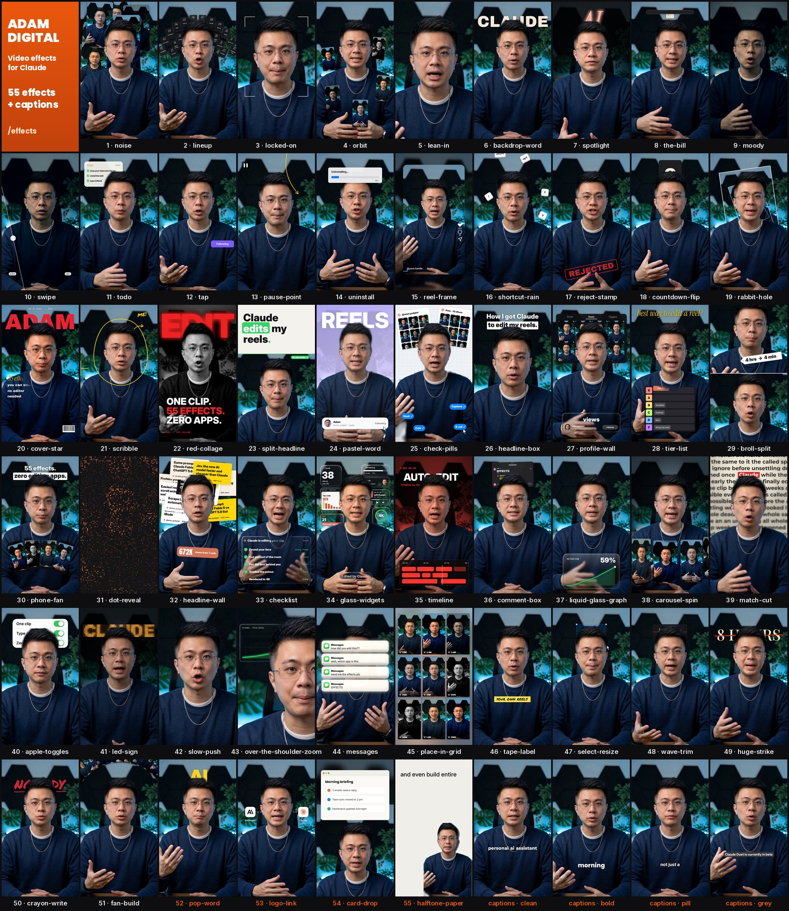

# aitjb 影片特效包 for Claude

把你的口播影片丟進 Claude Code，輸入 `/effects`。37 個特效、繁體中文逐字字幕、音效、自動剪停頓，一次搞定。

由 **Olivia（[@ai_tjb](https://www.instagram.com/ai_tjb)）** 整理製作。我把 AI 工具拆成白話教學，這個特效包是我自己做 reel 用的版本，免費分享。



## 安裝(一行)

打開「終端機」(或 Claude Code 裡的終端機)，貼上：

```bash
git clone https://github.com/aitjb/aitjb-reel-effects ~/.claude/skills/effects
```

Windows(PowerShell)把 `~/.claude/skills/effects` 換成 `$HOME\.claude\skills\effects`。

然後重開 Claude Code，就好了。

> 不會用終端機？打開 Claude Code 貼上這句：**「幫我從 github.com/aitjb/aitjb-reel-effects 安裝 skill 到 ~/.claude/skills/effects」**，Claude 會幫你裝。

> 那個資料夾裡已經有別的特效包？先把它刪掉，`/effects` 才會跑這一包。

## 怎麼用

1. 打開 Claude Code(app 或終端機都可以)。
2. 把影片拖進對話。
3. 打你想要的：

```
/effects 幫我整支剪
/effects 加字幕
/effects 先剪掉停頓，再加 bold 字幕
/effects 分身列隊 從 3 到 6 秒
/effects 報紙頭版 頭條寫「AI 取代剪輯師？」 開場 2 秒
/effects 講到「數據」的時候 用彈跳長條圖，數字 12、30、58
```

中文名、英文名(`clone-row`)、底線寫法(`paper_cut`)都可以。

第一次用，Claude 會自己安裝(大約 2 分鐘)，並問你的名字和帳號，讓個人資料卡顯示你。需要 `ffmpeg` 和 Python，沒有的話會幫你裝。

Claude 會先檢查幾張畫面，修掉蓋到臉的地方，再把 `你的影片_effects.mp4` 存在原檔旁邊。

## 你會得到

- **37 個會追蹤你臉的特效**，會蓋到臉的東西都放到你頭後面。
- **繁體中文優先**：畫面上的中文自動換成思源黑體、思源宋體、霞鶩文楷；中文口白自動轉台灣繁體字幕，按字數斷句，中英之間留空格。
- **剪停頓**：把空白剪掉，句子之間留一口氣，保持你原本的語速。
- **音效**：效果出現時加上輕輕的 pop 和 tick，用程式產生，沒有音檔授權問題。
- **整支剪流程**：`/effects 幫我整支剪` 會剪停頓、加字幕、在關鍵字放特效。

## 37 個特效

| # | 打這個 | 中文名 | 效果 |
|---|---|---|---|
| 1 | `split-graph` | 彈跳長條圖 | 螢光長條圖在頭頂上方彈跳長高 |
| 2 | `orbit` | 繞頭轉圈 | 你的照片繞著頭轉 |
| 3 | `timeline` | 剪輯時間軸 | 剪輯軟體的時間軸疊在畫面上 |
| 4 | `apple-toggles` | 設定開關 | iPhone 設定開關一行一行打開 |
| 5 | `glass-widgets` | 透明面板 | 毛玻璃面板一片片浮在臉旁邊 |
| 6 | `check-pills` | 勾選按鈕 | 方格紙房間，游標按下藍色按鈕 |
| 7 | `rabbit-hole` | 隧道 | 畫面像隧道一樣轉進去 |
| 8 | `red-collage` | 紅色拼貼 | 黑白的你，身後一個大紅字 |
| 9 | `carousel-spin` | 旋轉木馬 | 照片像旋轉木馬一樣轉，然後停住 |
| 10 | `liquid-glass-graph` | 玻璃圖表 | 玻璃卡片裡圖表往上長、數字往上跳 |
| 11 | `checklist` | 待辦清單 | 任務清單一項項打綠勾 |
| 12 | `led-sign` | LED 看板 | 燈暗下來，身後的看板打出字 |
| 13 | `match-cut` | 新聞切換 | 新聞一直換，紅框裡的字留在原位 |
| 14 | `over-the-shoulder-zoom` | 肩後拉近 | 推到一角出現圖表，再推到另一角 |
| 15 | `spotlight` | 發光字 | 房間變暗，你身後的字發光 |
| 16 | `ui-world` | 聊天畫面 | 白色聊天視窗降下，圖片飛進輸入框 |
| 17 | `phone-mockup` | 手機模型 | 大手機飛進來，按鈕被按下 |
| 18 | `glass-type` | 玻璃字 | 透明玻璃立體字站在身後，光線劃過 |
| 19 | `chart-grow` | 發光折線 | 發光的線往右上長，跳出大數字 |
| 20 | `paper-cut` | 剪紙拼貼 | 紙片疊在一起，定格動畫的節奏 |
| 21 | `messages` | 訊息通知 | 訊息通知從下面一則則疊上來 |
| 22 | `doodle-boil` | 蠟筆塗鴉 | 蠟筆線條圍著你一直抖動 |
| 23 | `headline-wall` | 標題牆 | 標題卡依序貼在你身後 |
| 24 | `cover-story` | 雜誌封面 | 大刊名從下方浮上來，變成雜誌封面 |
| 25 | `frame-break` | 衝出手機 | 影片縮進手機，肩膀以上衝出畫面 |
| 26 | `clone-row` | 分身列隊 | 身後排出 6 個分身，再被吸回你身上 |
| 27 | `code-body` | 程式碼身體 | 光由上往下掃，身體變成綠色程式碼 |
| 28 | `letter-dive` | 文字俯衝 | 紙上打出字，鏡頭飛進字裡變回影片 |
| 29 | `blade-slice` | 斬擊切片 | 白光斜劃過，畫面錯開再合回來 |
| 30 | `press-front` | 報紙頭版 | 畫面變成報紙頭版，你在網點照片裡說話 |
| 31 | `head-stack` | 頭頂疊標籤 | 標籤掉下來疊在頭上，最後崩塌 |
| 32 | `banknote` | 紙鈔 | 你變成一張虛構的紙鈔風鈔票 |
| 33 | `live-cursor` | 即時游標 | Claude 游標連框把你拖到旁邊再放回 |
| 34 | `paper-tear` | 撕報紙 | 報紙從中間撕開，露出你 |
| 35 | `impact-frame` | 漫畫衝擊格 | 黑白漫畫格加集中線，黑白一直反轉 |
| 36 | `blow-away` | 隨風消散 | 身體化成沙粒飄走，只剩空畫面 |
| 37 | `sketch-words` | 鉛筆手寫字 | 奶油色紙上，身後出現鉛筆手寫字 |
| + | `captions` | 字幕 | 逐字字幕：`clean`、`bold`、`pill`、`grey` |

## 小提醒
- 直式手機影片、人在畫面中、頭頂留一點空間，效果最好。
- 時間用說的就好(「講到『免費』的時候」)，Claude 會找到準確的秒數。
- 想讓 `orbit`、`carousel-spin`、`check-pills` 用你自己的照片？給 Claude 一個圖片資料夾。
- 圖表、數字、頭條請用你自己的真實數字，跟 Claude 說是多少。
- `blow-away`、`live-cursor` 會把你從畫面拿掉，空出來的背景是補出來的，背景越單純越好看。
- 發布前自己看一遍。Claude 打草稿，你拍板。
- 不會加背景音樂，想要的話到 CapCut 放一首。
- 預設輸出 1080p，要 4K 跟 Claude 說(比較慢)。

## 出問題怎麼辦
直接跟 Claude 說你看到什麼(「字蓋到我的臉」「字幕太大」「太快了」)，它會改計畫再輸出一次。

## 致謝
- 特效引擎：[claude-video-effects](https://github.com/Vibha-Ramprakash/claude-video-effects)，作者 Vibha Ramprakash(MIT)。
- 字幕、剪停頓、音效、個人資料設定：[claude-reel-effects](https://github.com/adamgodigital/claude-reel-effects)，作者 Adam Digital(MIT)。
- 37 個特效的清單與靈感：しほの演出スタジオ 的 vol.003、vol.10、vol.15 頁面。aitjb 新增的 21 個特效(vol.003 全部、vol.10 的 8 個、`split-graph`)由 @ai_tjb 用程式重新實作，沒有使用原頁面的程式碼或素材。
- 人臉追蹤：OpenCV YuNet(MIT)。人像去背：MediaPipe Selfie Segmenter(Apache 2.0)。逐字時間：faster-whisper(MIT)。簡轉繁：OpenCC(Apache 2.0)。品牌 logo：Simple Icons(CC0)，logo 為各品牌的商標。
- 字型：思源黑體 Noto Sans TC、思源宋體 Noto Serif TC、霞鶩文楷 LXGW WenKai TC、jf open 粉圓(以上 SIL OFL)，以及 Archivo Black、Instrument Serif、Space Mono、Inter、Anton、Montserrat、Playfair Display、Poppins(SIL OFL)和 Permanent Marker(Apache 2.0)。授權檔在 `fonts/`。
- 其他部分：MIT，見 `LICENSE`。
